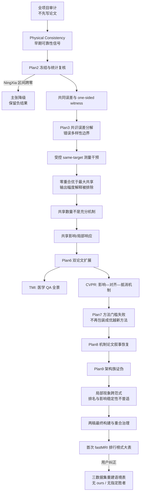

# 本轮对话全流程：研究思路、证据路径与决策节点

更新时间：2026-08-21  
工作根目录：`D:\MRI\design\paper`  
覆盖时段：从初始 `/goal` 研究审计，到三数据集重建语境表完成后的当前状态

## 0. 文档说明

本文不是聊天记录的逐字转写，也不是不可验证的内部心理活动或逐 token 推理。它整理的是本轮对话中能够由用户指令、实验文件、报告、代码、日志、PDF、Git 状态和数值结果共同复核的决策过程：

- 用户在每个阶段要求了什么；
- 当时最大的科学不确定性是什么；
- 为什么选择某个实验或论文定位；
- 哪些结果支持了假设；
- 哪些结果否定或削弱了假设；
- 这些证据怎样改变了下一步；
- 两篇论文怎样形成、分工和产生重合治理问题；
- 最后一次表格需求为什么先被误读，又怎样纠正。

状态标记约定：

- **已支持：** 有实际实验、统计量和可追踪产物支持；
- **被否定：** 预期未通过冻结门槛，或反例足以否定强命题；
- **有边界支持：** 方向成立，但只适用于特定数据集、模型、平面、指标或统计层级；
- **仅探索性：** 未通过确认性门槛，不能进入主张；
- **未完成/人工依赖：** 需要新数据、伦理信息、作者决定、投稿政策判断或新授权。

## 1. 用户指令的完整推进顺序

| 顺序 | 用户指令 | 对研究工作的实际影响 |
|---:|---|---|
| 1 | 按 `goal.md` 执行，产物放在 `design/paper` | 从“直接写论文”改成对整个 `design` 研究库做审计、建立假设—实验—证据状态，并禁止伪造和先定故事后挑结果 |
| 2 | 按 `plan2.md` 继续 | 不把早期 Physical Consistency 结果当终点；冻结方法、重做统计、检验脆弱性、共同误差与外部复现 |
| 3 | 按 `plan3.md` 继续 | 将项目从单一评分方法推进到“共识误差、错误多样性、上下文几何与预重建难度”的开放研究前沿 |
| 4 | 加上 IXI | 把 115 个 IXI 检查纳入主要复现、机制分析与回顾性 ×4→×2 后果，降低只依赖两个小队列的风险 |
| 5 | 接着实验并丰富文章 | 形成 Plan4–Plan7：受控测量干预、双论文路线、完整实验扩展、审稿风险优化和失败方法门槛 |
| 6 | 整理两篇文章进展为 Markdown | 形成双稿进展报告，明确 TMI 与 CVPR 的证据所有权和剩余缺口 |
| 7 | 将本次产物压缩为 ZIP | 生成多轮归档包与 manifest，保留阶段性可交付状态 |
| 8 | 按 `plan8.md` 重新 build CVPR | 放弃“新可靠性方法/SOTA”包装，恢复为由受控干预和误差分解支撑的机制论文 |
| 9 | 汇总最终结果为 Markdown | 形成 Plan8、Plan9 和总中文报告，集中记录结论、负结果、论文状态与风险 |
| 10 | 整理 `design/paper` 并写完整中文文档 | 建立较清晰的 TMI、CVPR、Plan9、归档与总报告入口 |
| 11 | 推送到 GitHub | 将当时已完成的论文和 Plan9 证据以提交 `fccf675` 推送到 `DurianLoop/voxelweave` 的 `main` |
| 12 | 确认 | 对远端与提交状态进行确认 |
| 13 | 要求制作类似 I3Net Table I 的大表 | 第一版按视觉样式做成 fastMRI 单数据集、×2/×4/×6、13 方法排行榜式表格 |
| 14 | 指出应结合两篇论文和三个数据集，且不是为了突出 I3Net | 撤销排行榜逻辑，重建为 fastMRI/IXI/NingXia 三数据集语境表，不设 “ours”，不突出指定模型 |
| 15 | 要求回顾全部信息和思考节点 | 形成本文档 |

## 2. 整体决策路径图

这条路径最重要的特征是：每次“变强”并不等于数值变大，而是命题变得更可证伪、统计单位更正确、竞争解释更少、适用边界更清楚。

## 3. 起点：从重建性能工程转向可靠性科学问题

### 3.1 初始项目是什么

`D:\MRI\design` 中已有多条 MRI 层间插值路线，包括 I3Net、HAT、SwinIR、SAINT、SMamba-UNet、PastNet、ACSI-Net、解析插值以及 RASINet 可靠性研究。传统任务是从稀疏轴向切片恢复缺失平面，并以 MAE、PSNR、SSIM 等指标评价重建质量。

真正的部署问题是：测试时没有稠密真值，模型即使输出平滑、合理的切片，也不知道当前检查是否应该被复核。因此研究重心从“哪个重建器平均分数最好”转向：

> 在没有稠密真值时，怎样判断一个确定性 MRI 插值结果可能失败；为什么一些看似一致的预测会共同出错？

### 3.2 初始审计的关键发现

初始完整审计见 [AUDIT_REPORT.md](AUDIT_REPORT.md)。主要结论是：

- 固定跨模型分歧可以较强地排序检查级 MAE，但不能可靠定位具体体素或确定哪个模型错；
- 灵活委员会选择容易对小队列难度过拟合；初始选择器和后续修订都未在冻结外层验证中胜过固定基线；
- 跨模型分歧在代数上会抵消多个模型共同拥有的误差分量；
- 同一模型、同一物理平面、不同采样因子产生的 Physical Consistency 信号更有科学潜力；
- ACSI-v2.1、目标归因、若干 PastNet 结构/校准方向均出现负结果，不能被写成贡献；
- 最早的 NingXia 正结果样本很小，且统计处理必须以患者/检查为单位，不能把像素或重复序列当独立样本。

### 3.3 第一个重要转向

最早可以写成“我们有一个更好的可靠性分数”，但审计选择了更难也更科学的方向：研究分歧到底能观察误差的哪一部分，以及共同误差为什么会被隐藏。

这奠定了后续所有工作的基本区分：

- **重建精度：** 某个模型与真值相差多少；
- **输出多样性：** 两个预测彼此相差多少；
- **错误可观测性：** 预测差保留了多少真实配对误差；
- **可靠性排序：** 某个分数能否在检查级排序失败风险；
- **正确性证书：** 低分是否能证明结果正确——本项目明确不能。

## 4. Plan2：先冻结、再试图推翻早期结果

### 4.1 为什么不能直接继续优化

`plan2.md` 将早期 Physical Consistency 定义为“有希望的中间发现”，要求冻结当前方法，优先验证它是否脆弱，而不是继续调参把分数做漂亮。

关键检验包括病例影响、患者/检查聚类统计、风险—覆盖曲线、异质性、外部/独立复现、共同模式盲区、TTA 比较、几何与强度混杂、定位能力和 consistent-but-wrong 情形。

### 4.2 统计纠正节点

早期 NingXia 的 profile-aligned 统计给出过于乐观的显著性。改用正确的检查/患者聚类后，Physical Consistency 相对固定委员会的 nAURC 差为：

- `ΔnAURC = -0.0256`；
- 95% CI `[-0.0957, 0.0092]`；
- rank-permutation `p = 0.164`。

区间跨零，因此 NingXia 的“显著优越”主张被主动降级。这个节点很重要：项目没有因为早期报告已经写好就保留错误显著性，而是让统计纠正改变结论。

### 4.3 Plan2 得到什么、否定什么

完整总结见 [PLAN2_EXECUTION_SUMMARY.md](PLAN2_EXECUTION_SUMMARY.md)。

得到的结果：

- 1,518/1,518 对世界坐标匹配通过，目标物理平面偏差为 0 mm；
- fastMRI 提供了更强的确认性证据；
- natural consistent-but-wrong 案例存在；
- Physical Consistency 对不同因子对和强度尺度敏感，不能假设一个普适绝对阈值；
- 分歧只能作为单向失败见证：分歧大说明至少一个结果有误，但分歧小不能证明正确。

被否定或未支持的方向：

- 一般性共同错误检测器；
- 稳定的个体模型错误归因；
- 简单混合分数优于 Physical Consistency；
- TTA 比较足以证明 Physical Consistency 对所有扰动都独特；
- 从小样本均值直接推出强临床结论。

### 4.4 由 Plan2 产生的新问题

既然 Physical Consistency 有效但只能观察部分误差，下一步不应继续问“怎样再提高 0.01 的相关性”，而应问：

1. 误差中有多少是多个架构共同拥有的；
2. 什么样的上下文变化能暴露共同误差；
3. 输出差异越大是否真的越有用；
4. 采样、病例本身和架构分别解释多少误差方差。

## 5. Plan3：从单一分数扩展到共识误差理论

### 5.1 核心发现

[PLAN3_RESEARCH_REPORT.md](PLAN3_RESEARCH_REPORT.md) 将研究提升为一个更一般的解释：确定性 MRI 插值失败主要是病例与采样共同决定的内在难度，不同架构常常在相同检查上失败；跨上下文分歧只观察较小的上下文敏感误差，主导的共识误差仍可能不可见。

关键数值：

- 病例方差占比：fastMRI `0.583 [0.428, 0.667]`，NingXia `0.839 [0.588, 0.880]`；
- 因子方差占比：`0.258` 与 `0.125`；
- 架构方差占比：`0.103` 与 `0.006`；
- 138 个病例—架构单元全部满足 ×2 < ×4 < ×6 的误差顺序；
- fastMRI 11 个神经家族的病例误差秩相关中位数为 `0.961`；IXI 六方法为 `0.991`；
- 精确 MSE 分解中，共识误差占 `80.9%/86.5%`，可观测多样性仅占 `19.1%/13.5%`。

### 5.2 边界与机制线索

NingXia ×4–×6 的 stable-wrong 事件集中在首个生成平面。源数据排除了缺失覆盖和零填充；两个上下文共享左侧锚点，使高误差情况下的输出仍彼此接近。目标曲率与误差相关 `ρ=0.936`。四病例冻结 HAT 合成干预中，替换首个左锚点使首区间误差增加 42.8，而内部误差基本不变。

这支持“局部边界上下文敏感性”，但由于 NingXia 只有八位患者，不能把其发生率写成普遍规律。

### 5.3 TTA 与“输出多样性”假设

两队列、三倍率、三个主要架构的四视图 flip-TTA 比较中，Physical Consistency 在 18 个 profile 上全部更好。它支持“改变物理采样上下文比简单翻转更能暴露误差”，但不证明它优于一切可能的扰动。

更重要的否定是：

> 输出差异大本身不是好的可靠性干预；干预必须保持目标身份，并改变造成共同错误的有效信息。

这成为后续受控测量干预的设计原则。

## 6. IXI 加入后的作用

用户明确要求“加上 IXI”，这不仅增加一个数据集名字，而是改变了证据结构。

### 6.1 IXI 的统计角色

- 115 个独立 held-out brain T2 检查；
- 相比 fastMRI 的 24 个检查和 NingXia 的 8 位患者，IXI 提供更高精度的主要复现；
- 机制实验中，IXI 的 disjoint-minus-shared 排名差为 `0.095 [0.078, 0.126]`；
- clean shared 条件下仅 `1.58%` 的配对误差能量可由分歧观察；
- Anchor-CV 与 ×4 检查误差相关 `ρ=0.955`，与回顾性 ×4→×2 收益相关 `ρ=0.948`。

### 6.2 IXI 的覆盖边界

IXI 不是所有实验都有完整 ×2/×4/×6 神经结果。当前重建性能审计中，完整可比覆盖仅为 ×4 下：

- Linear；
- Cubic；
- ACSI-Net；
- HAT；
- I3Net；
- SwinIR。

SAINT、CycleINR 等方法没有被用不兼容或零散结果补齐。这个“缺口显式保留”原则后来直接决定了三数据集大表中 IXI ×2/×6 使用“—”。

## 7. Plan4：从相关性转向同目标受控测量干预

### 7.1 中心实验

Plan4 构造相同缺失目标、相同模型和相同掩膜，仅改变支持预测的物理锚点身份：

- phase-0：`z = 0,4,8,...`；
- phase-2：`z = 2,6,10,...`；
- 二者对共同缺失目标使用零重合锚点；
- 最大共享对照复用同一组锚点。

关键结果：

| 队列 | 零重合误差排序 ρ | 最大共享 ρ | 差值 | 聚类 95% CI |
|---|---:|---:|---:|---:|
| fastMRI | 0.960 | 0.605 | 0.355 | [0.225, 0.557] |
| NingXia OOF | 0.891 | 0.699 | 0.193 | [0.111, 0.306] |

HAT 与 SwinIR 分别复现；Linear/Cubic 也给出强相关，因此不是 Transformer 特有现象。

这一阶段的“最大共享”使用 through-plane reversal，后来被确认含有锚点顺序/方向等变性的混杂。因此它保留为历史支持和困难负对照，但不再承担最终 clean causal contrast。Plan8/Plan9 在观察整队列新结果前改用映射回原坐标的 in-plane horizontal flip，保持物理锚点身份与 z 顺序，所以下一节的 clean-control 数值与这里的历史 all-plane 数值属于不同预先声明的 estimand，不能互相替换。

### 7.2 排除“只是差异更大”

fastMRI 中，零重合上下文的原始分歧幅度只有最大共享的 0.59–0.77 倍，却能更好排序误差。因此收益不是因为输出差距机械变大，而是因为错误方向不再被相同测量强制对齐。

### 7.3 受控实验形成的新原则

> 保持目标不变，改变负责产生错误的测量；优化错误方向独立性，而不是最大化原始输出多样性。

这一步把“Physical Consistency 是一个有效分数”升级为“测量依赖决定分歧能看到多少错误”的机制命题。

## 8. Plan5–Plan7：双论文形成、扩展和失败门槛

### 8.1 为什么分成 TMI 与 CVPR 两条线

Plan5 将共享研究基础分成两个不同科学所有权：

- **TMI：** 面向医学成像技术 QA，强调队列、指标、因子、几何、强度、stable-wrong、选择性风险、成本和临床边界；
- **CVPR：** 面向更抽象的测量依赖机制，强调共享影响、误差对齐、分歧抵消、固定计数检验和方法门槛。

这种分工不是把一篇论文拆成两份，而是尝试让一个研究现象回答两个不同层级的问题。但后续审计确认两稿仍共享重要实验，不能仅靠低文字相似度消除科学重合风险。

### 8.2 Plan6：用新科学扩展，而不是凑页数

[PLAN6_FINAL_AUDIT.md](PLAN6_FINAL_AUDIT.md) 记录了两条线的系统扩展。

TMI 新增：

- 七种误差端点的稳健性；
- 完整共识/可观测误差分布；
- ×2/×4/×6 因子边界；
- 几何与强度审计；
- 病例/患者聚类推断；
- 风险—覆盖、回顾性加密收益和成本；
- 错误分类与负结果。

CVPR 新增：

- 神经有限差分共享影响；
- 影响→误差对齐→抵消/可观测性的箭头式检验；
- 固定共享计数控制；
- Anchor-CV 冻结复现与相邻锚点强基线；
- IXI ×4→×2 后果；
- 架构无关难度和失败分类。

### 8.3 Plan7：方法门槛失败是一次关键转折

Plan7 不满足于“机制有趣”，而是尝试从机制推出更强的新能力：

- minimum-influence 上下文选择；
- multi-anchor jackknife；
- 共享影响残差化；
- 机制驱动训练；
- 加密收益能力。

冻结门槛后的结果：

- minimum-influence 选择没有形成可迁移的优越能力；
- multi-anchor jackknife 没有提供超过 adjacent MAE 的增量信息；
- 协方差残差化没有稳定提高可靠性；
- 神经影响不具物理平面不变性；
- Anchor-CV 与简单 adjacent MAE/RMSE 基本相当；
- 不存在一个跨队列普遍最优的可靠性分数。

因此 Plan7 的 CVPR 方法论文模拟分数下降，最终建议 `MERGE_OR_SEQUENCE_REQUIRED`。正确响应不是隐藏失败，而是停止把 CVPR 包装成“优越新方法”。

## 9. Plan8：CVPR 叙事恢复为机制论文

用户随后明确要求按 `plan8.md` 重新 build CVPR。Plan8 的核心不是美化文字，而是重新定义论文评价标准：不按 SOTA 方法论文评分，而按机制论文看它是否有清楚的现象、受控干预、竞争解释排除、边界和实际后果。

### 9.1 最终机制链

CVPR 最终围绕以下结构重建：

`共享物理测量 → 共享局部估计器影响 → 错误方向对齐 → 预测差抵消 → consensus blindness`

基础恒等式是：

`||f_a-f_b||² = ||e_a||² + ||e_b||² - 2<e_a,e_b>`。

代数恒等式本身不是新颖性；真正的科学问题是：什么物理条件决定误差内积，以及这一条件能否被受控改变。

### 9.2 三队列 clean-control 结果

| 队列 | disjoint − shared 排名 ρ | 95% CI | clean-shared 可观测误差能量 |
|---|---:|---:|---:|
| fastMRI | 0.092 | [0.043, 0.176] | 2.61% |
| IXI | 0.095 | [0.078, 0.126] | 1.58% |
| NingXia | 0.193 | [0.111, 0.371] | 0.25% |

### 9.3 原始共享数量被否定为充分机制

精确四锚点阶梯在三个队列均出现 0→1 共享数量反转，否定“每多共享一个锚点，误差可观测性就严格单调下降”。这推动模型从离散 count 转向连续 shared influence。

解析插值中，共同系数质量与误差对齐的相关性显著高于共享数量；HAT/SwinIR 的局部有限响应也在主要端点上给出 `0.036–0.089` 的影响相对计数优势。但固定计数 NingXia 为 null/mixed，平面稳定性只通过一组，因此最终主张严格限定为局部属性和特定队列的附加解释。

### 9.4 Anchor-CV 的正确定位

Anchor-CV 是 acquired-only、低成本的检查级信号，但不是论文核心新颖性或普遍最优方法。

- fastMRI/IXI/NingXia 检查难度相关：`0.943/0.955/0.958`；
- adjacent MAE：`0.934/0.956/0.973`；
- IXI 中 output PC 在部分预算下更强。

结论因此是“可解释、无需额外神经调用”，而不是“提供唯一信息”或“SOTA”。

### 9.5 Plan8 的结果

[CVPR_plan8_final_report.md](CVPR_plan8_final_report.md) 记录的模拟评审为 4/4/3/4/4，中位数 4。恢复的原因不是删除负结果，而是让论文的中心命题与真正通过证据门槛的机制一致。

## 10. Plan9：架构族证伪，而不是再堆基线

Plan9 恢复 13 个可审计重建方法，并把 I3Net、适配 SAINT-style 网络、内部 CycleINR-style 模型加入 fastMRI ×4 的 same-target shared/disjoint 实验。目的不是证明某个重建器最好，而是试图推翻“现象只存在于 HAT/SwinIR 两个相关 Transformer”的解释。

### 10.1 架构族主结果

| 架构 | 家族 | 可观测误差增益 | 排名差及 95% CI |
|---|---|---:|---:|
| HAT | Transformer SR | 17.8 pp [17.0,18.7] | +0.0565 [-0.0298,0.1857] |
| SwinIR | Transformer SR | 17.6 pp [16.4,18.8] | +0.0617 [-0.0509,0.2344] |
| I3Net | inter/intra CNN | 8.0 pp [7.2,8.8] | +0.0183 [-0.0613,0.1075] |
| SAINT | spatial conditional CNN | 13.7 pp [12.5,14.9] | -0.0096 [-0.1425,0.1139] |
| CycleINR | implicit coordinate | 22.6 pp [21.9,23.3] | +0.3417 [0.1129,0.7108] |

所有架构的局部可观测误差增益为正，但检查级排名改善高度异质：CycleINR 明确改善，I3Net 接近零，SAINT 略为负且不确定。

### 10.2 有限差分影响稳定性边界

- SAINT 稳定性 `ρ=0.940/0.964/0.995`，全部通过；
- I3Net 为 `0.859/0.737/0.939`，两个门槛失败；
- CycleINR 为 `0.779/0.857/0.876`，三个替代设置失败。

所以可以说现象跨已评估插值范式，但不能说影响探针跨架构普适稳定，更不能说 `architecture independent`。

### 10.3 架构多样性不等于误差独立

fastMRI 的病例级误差秩相关中位数在 ×2 为 `0.9448`，×4/×6 为 `0.9813`。不同模型仍在同一批检查上共同失败。像素级错误方向却可能更有差异：HAT–SwinIR error cosine `0.918`，CycleINR–I3Net 为 `0.564`。

因此两个看似矛盾的事实可以同时成立：病例难度高度共享，但局部误差方向可以因架构而更多样。

完整 Plan9 结论见 [PLAN9_ARCH_GENERALIZATION/FINAL_REPORT.md](PLAN9_ARCH_GENERALIZATION/FINAL_REPORT.md)。

## 11. 两篇论文最终定位与相互关系

### 11.1 TMI

题目：*Measurement Dependence Governs Disagreement-Based Reliability in Deterministic MRI Slice Interpolation*。

核心所有权：

- 三个 MRI 队列的医学成像 QA；
- 多指标、多因子、几何与强度边界；
- stable-wrong、risk–coverage、运行代价；
- 架构范式是否共享同一个 QA 盲点；
- 临床外部效度和患者聚类限制。

当前成稿：[TMI/TMI_ARCH_GENERALIZED/main.pdf](TMI/TMI_ARCH_GENERALIZED/main.pdf)，10 页；三数据集重建语境表位于第 7 页。

### 11.2 CVPR

题目：*When Agreement Hides Error: Shared Measurement Influence in MRI Slice Interpolation*。

核心所有权：

- 物理测量依赖干预；
- count falsification；
- 共享影响、误差对齐和抵消的局部机制链；
- finite-response 稳定性边界；
- Anchor-CV 作为非优越、低成本后果；
- 架构族机制证伪。

当前主文：[CVPR/CVPR_ARCH_GENERALIZED/PAPER/main.pdf](CVPR/CVPR_ARCH_GENERALIZED/PAPER/main.pdf)，9 页，其中科学内容 8 页、参考文献第 9 页。  
当前补充：[CVPR/CVPR_ARCH_GENERALIZED/PAPER/supplement.pdf](CVPR/CVPR_ARCH_GENERALIZED/PAPER/supplement.pdf)，5 页；三数据集重建语境表位于第 2 页。

### 11.3 重合治理

段落 TF-IDF 诊断中，TMI 66 段与 CVPR 42 段只有一组超过 0.45，高匹配文字占比约 1.59%。但这不是 iThenticate 结果，而且两篇论文共享 fastMRI 架构实验，科学重合仍然实质存在。

最终治理结论是：`MERGE_OR_SEQUENCE_REQUIRED`。不能因为文字相似度低就默认并行投稿合规；需要作者检查两家 venue 政策、披露共享实验，并选择合并或错峰。

## 12. 大表需求：一次重要的需求误读与纠正

### 12.1 第一版为什么错

用户提供了 I3Net 论文中类似 Table I 的截图。第一版把“类似”理解成：

- ×2/×4/×6 纵向分块；
- 方法固定排序；
- 展示多个指标；
- 最佳值粗体、次佳值下划线。

于是生成了 fastMRI 单数据集、13 方法、五指标的榜单式表，并在文字上说明 I3Net 在该本地协议中最强。虽然数值真实、表格可编译，但它没有抓住用户真正的语义：这张表应服务于两篇已有论文和三个数据集，而不是模拟一篇以 I3Net 为 “ours” 的重建论文。

### 12.2 用户纠正后的设计原则

纠正后采用：

- fastMRI、IXI、NingXia 三个列组；
- ×2、×4、×6 三个倍率块；
- 每个数据集展示 MAE、PSNR、SSIM、NCC；
- 不设置 “ours”；
- 不加粗最佳/次佳；
- I3Net 放在字母序中部，不形成视觉上的主方法行；
- 真实缺失组合写 “—”，不插值、不抄异构论文数字、不把不可审计结果当完整结果；
- MAE 只在队列内部解释，不跨不同强度范围池化。

### 12.3 数据覆盖

| 数据集 | 单位 | 覆盖 |
|---|---:|---|
| fastMRI brain T2 | 24 个检查 | 13 方法，×2/×4/×6 |
| IXI brain T2 | 115 个检查 | ×4 下 6 方法 |
| NingXia knee T2 | 8 位患者、22 个 OOF 序列 | 13 方法，×2/×4/×6 |

ACSI-Net 只在 IXI ×4 有完整结果，因此在固定方法顺序的其它块中显示“—”。ACVTT 与 ACSI-Net 是不同方法，没有互相冒名替代；历史预期的 ACVIT 未恢复，也未伪造。

### 12.4 为什么三数据集表自然消解了 I3Net 中心叙事

I3Net 在 fastMRI 若干组合中误差较低，但在 NingXia 并非普遍占优；HAT、SwinIR 或其它模型在不同倍率/指标上可以更好。更关键的是，这两篇论文的主张不是提出重建骨干，而是研究共享测量如何使不同确定性结果共同犯错。因此重建表应是实验语境和覆盖审计，不应成为“主方法获胜”的证据。

### 12.5 最终表格产物与验证

- TMI 表源：[TMI/TMI_ARCH_GENERALIZED/table_full_reconstruction_benchmark.tex](TMI/TMI_ARCH_GENERALIZED/table_full_reconstruction_benchmark.tex)
- CVPR 表源：[CVPR/CVPR_ARCH_GENERALIZED/PAPER/table_full_reconstruction_benchmark.tex](CVPR/CVPR_ARCH_GENERALIZED/PAPER/table_full_reconstruction_benchmark.tex)
- 独立 PDF：[PLAN9_ARCH_GENERALIZATION/p9_full_reconstruction_benchmark_table.pdf](PLAN9_ARCH_GENERALIZATION/p9_full_reconstruction_benchmark_table.pdf)
- 独立 PNG：[PLAN9_ARCH_GENERALIZATION/p9_full_reconstruction_benchmark_table.png](PLAN9_ARCH_GENERALIZATION/p9_full_reconstruction_benchmark_table.png)
- 中文说明：[PLAN9_ARCH_GENERALIZATION/FULL_RECONSTRUCTION_BENCHMARK_TABLE_ZH.md](PLAN9_ARCH_GENERALIZATION/FULL_RECONSTRUCTION_BENCHMARK_TABLE_ZH.md)
- 机器可读宽表：`PLAN9_ARCH_GENERALIZATION/outputs/p9_three_cohort_reconstruction_benchmark.csv`

验证结果：

- 宽表相对原始 fastMRI/IXI 汇总和 NingXia OOF 逐序列结果共检查 504 个展示字段，0 个不一致；
- TMI 与 CVPR 两个 LaTeX 表各解析 42 行，均与宽表 0 不一致；
- TMI、CVPR 主文和 CVPR 补充材料无未解析引用、LaTeX error 或 overfull box；
- 逐页渲染检查确认 TMI 第 7 页和 CVPR 补充第 2 页无列溢出。

## 13. 主要假设的最终判定

| 命题 | 最终状态 | 为什么 |
|---|---|---|
| 跨上下文分歧能作为失败信号 | 有边界支持 | 能较强排序检查误差，但只观察不共享的误差分量 |
| 低分歧证明重建正确 | 被否定 | 共同误差会在预测差中抵消 |
| Physical Consistency 普遍优于所有可靠性信号 | 被否定 | 不同队列/预算/比较器有不同胜者 |
| 输出多样性越大越可靠 | 被否定 | 零重合的原始分歧可更小却更能排序误差 |
| 测量重叠影响错误可观测性 | 已支持 | same-target 零重合与共享对照在多队列、神经/解析估计器中有稳定差异 |
| 共享锚点数量构成严格单调定律 | 被否定 | 精确阶梯出现 0→1 反转 |
| 连续共享影响比计数更有解释力 | 有边界支持 | 解析和 HAT/SwinIR 主端点支持；NingXia 固定计数与平面稳定性限制普适性 |
| Anchor-CV 是独特或普遍最优的新方法 | 被否定 | adjacent MAE/RMSE 基本相当，output PC 部分更强 |
| 现象只存在于 HAT/SwinIR | 被否定 | I3Net、SAINT、CycleINR 的局部可观测误差增益均为正 |
| disjoint 总会改善检查级排序 | 被否定 | SAINT 略负、I3Net 接近零且区间跨零 |
| 有限差分影响在所有架构稳定 | 被否定 | 只有 SAINT 通过新架构全部门槛 |
| 架构多样性意味着病例级错误独立 | 被否定 | 跨模型病例误差秩相关仍约 0.94–0.99 |
| 结果可称为 architecture independent | 不允许 | 最多表述为 across evaluated interpolation paradigms |
| 已证明临床安全或前瞻扫描收益 | 未支持 | 所有网格来自回顾性模拟，无读者研究和前瞻干预 |

## 14. 负结果如何真正改变研究路径

本轮最值得分析的不是成功列表，而是负结果承担了什么决策功能：

1. **委员会搜索过拟合** → 放弃把大规模候选搜索当贡献，转向固定、可解释干预；
2. **NingXia 统计降级** → 强制使用患者聚类，并把小队列定位为边界而非主要精度来源；
3. **目标归因失败** → 不再从检查级排序推断具体模型或像素归因；
4. **TTA 未形成一般优势解释** → 把主张限定为已测试扰动；
5. **输出幅度解释失败** → 提出错误方向独立性而非多样性大小；
6. **共享计数非单调** → 从 overlap count 转向 shared influence；
7. **Anchor-CV 不独特** → 将其降为轻量后果，不做中心新方法；
8. **Plan7 三个能力门槛失败** → CVPR 从方法论文恢复为机制论文；
9. **新架构影响稳定性失败** → 保留“现象跨范式”，撤销“影响探针普适”；
10. **首次大表误读** → 从突出单模型的排行榜改为三数据集覆盖语境表。

这说明项目的科学进展主要来自“删掉不成立的强说法”，而不是不断追加看似积极的数字。

## 15. 数据、指标与统计层级的统一理解

### 15.1 数据集

- fastMRI：112/24/24 划分，论文分析使用 24 个测试检查；
- IXI：404/58/115，主要分析使用 115 个 held-out 检查；
- NingXia：8 个患者折、22 个 OOF 序列，推断必须以 8 位患者为聚类单位。

### 15.2 重建指标

- MAE、RMSE/MSE：强度误差；
- PSNR：与 MSE 相关的对数质量；
- SSIM：结构相似性，但作为错误排序端点在部分队列较弱或方向异常；
- NCC：全局强度相关；
- 梯度、低频、高频误差：用于检验主结果是否只来自特定频段。

### 15.3 可靠性与机制指标

- disagreement：两个输出之差；
- error cosine/shared fraction：配对误差对齐与共享能量；
- observable fraction：能在输出差中保留下来的配对误差比例；
- Spearman ρ：检查/上下文排序能力；
- nAURC：风险—覆盖质量；
- clustered bootstrap/permutation：以检查或患者作为独立重采样单位。

### 15.4 不能混用的层级

- 像素级误差方向多样性不等于病例级难度独立；
- 重建 PSNR/SSIM 排名不等于可靠性评分排名；
- 队列内 MAE 不能直接跨不同强度范围比较；
- 22 个 NingXia 序列不能被写成 22 位独立患者；
- 回顾性模拟的加密收益不能被写成前瞻性扫描收益。

## 16. 产物、归档与 Git 状态

### 16.1 主要报告入口

- 总中文报告：[FINAL_COMPREHENSIVE_REPORT_ZH.md](FINAL_COMPREHENSIVE_REPORT_ZH.md)
- Plan9 总报告：[PLAN9_ARCH_GENERALIZATION/FINAL_REPORT.md](PLAN9_ARCH_GENERALIZATION/FINAL_REPORT.md)
- 双稿阶段报告：[TWO_PAPERS_PROGRESS_REPORT_20260813.md](TWO_PAPERS_PROGRESS_REPORT_20260813.md)
- 目录入口：[README.md](README.md)

### 16.2 历史 ZIP

`ARCHIVE_PACKAGES` 中保留：

- `dual_paper_current_artifacts_20260813.zip`；
- `plan6_dual_paper_deliverables_20260813.zip`；
- `plan7_current_artifacts_20260814.zip`；
- `plan7_final_artifacts_20260814.zip`。

这些 ZIP 是阶段快照，不自动包含 2026-08-20 完成的三数据集表格修订。

### 16.3 Git

- 远端：`https://github.com/DurianLoop/voxelweave.git`；
- 当前 `origin/main` 与本地 `HEAD` 指向 `fccf675 Add MRI interpolation papers and Plan 9 evidence`；
- 三数据集表格、两篇论文的对应文字和重新生成的 PDF 是该提交之后的本地修改，当前尚未推送；
- `PLAN9_ARCH_GENERALIZATION/outputs` 被 `.gitignore` 的 `**/outputs/` 规则忽略，因此新的三数据集 CSV 虽存在于本地，但默认不会出现在普通 `git status` 或后续提交中；若要推送，需要明确调整忽略规则或有意识地强制纳入；
- 工作树还包含 `fastmri_brain_pastnet_2p5d` 与 `docx/experiment_notes` 的其它用户修改，它们不属于本次表格修订，不能在后续提交时混入。

## 17. 当前可以怎样理解整个项目

### 17.1 最稳健的科学结论

> 在已评估的 MRI 层间插值范式中，复用相同物理测量会使确定性重建误差更加对齐，从而减少预测分歧能够观察到的错误；但这一局部误差几何现象并不保证检查级排序总会改善，也不保证有限差分影响探针在所有架构、平面或队列中稳定。

### 17.2 这不是哪些论文

- 不是 I3Net、SAINT 或 CycleINR 的新版本论文；
- 不是新的 MRI 超分辨率 SOTA 排行榜论文；
- 不是校准不确定性或临床安全证书；
- 不是证明 disjoint 上下文在任何情况下都最优；
- 不是证明 Anchor-CV 优于所有简单基线；
- 不是证明 shared influence 是跨架构、跨平面、跨领域的普适定律。

### 17.3 真正的贡献形状

1. 发现并量化 deterministic consensus blindness；
2. 用 same-target 物理测量干预隔离测量依赖；
3. 用误差分解解释为什么一致可能隐藏错误；
4. 用共享影响细化原始共享数量，同时公开它的固定计数、平面和架构边界；
5. 给出 acquired-only 检查信号作为实际后果，但不夸大优越性；
6. 通过多次失败门槛证明哪些更强命题不成立。

## 18. 尚未解决的事项

### 科学层面

- 没有 MRI 以外的经验泛化；
- 没有前瞻性改变扫描协议；
- 没有外部临床任务、读者研究或诊断终点；
- NingXia 只有八位独立患者；
- 新架构 clean shared/disjoint 实验主要限于 fastMRI ×4；
- IXI 的重建性能矩阵没有完整 ×2/×6 神经覆盖。

### 投稿治理

- TMI 与 CVPR 不能在未核对政策和披露共享实验的情况下直接并行投稿；
- 需要人工填写作者、单位、利益冲突、资助、伦理/知情同意或豁免、数据许可等信息；
- 模拟审稿分数只是内部风险评估，不是录用概率或保证。

### 工程与交付

- 2026-08-20 的三数据集表格修订尚未推送；
- 最新表格宽表受到 `.gitignore` 影响；
- 历史 ZIP 不包含最新修订；
- 若下一步要推送或重新压缩，应只选择 `design/paper` 的本轮修改，避免混入其它用户工作树文件。

## 19. 从这轮路径中可以提炼的研究方法论

1. **先审计再写论文。** 如果先写故事，委员会搜索、Anchor-CV 或 I3Net 排名都可能被错误地包装成中心贡献。
2. **正确统计单位比更小的 p 值重要。** NingXia 的降级提高了可信度，而不是削弱项目价值。
3. **把“效果好”拆成机制问题。** Physical Consistency 的真正价值不是一个 nAURC 数字，而是揭示分歧只观察非共享误差。
4. **设计能排除竞争解释的干预。** same-target、同模型、同掩膜，只换物理锚点身份，比比较两个任意模型更接近机制证据。
5. **负结果要改变路线。** count 反转、方法门槛失败和影响稳定性失败都实质修改了论文主张。
6. **数据集新增必须改变推断结构。** IXI 不是装饰性第三数据集，而是 115 检查的主要精度来源；NingXia 是外部解剖/站点边界；fastMRI 支持细致架构实验。
7. **重建表与论文主张要一致。** 当论文研究的是可靠性机制，大表应说明估计器语境和覆盖，而不是制造一个“ours”获胜的视觉叙事。
8. **两篇论文的文字差异不能替代科学治理。** 共享核心实验仍需合并、错峰或明确披露。

## 20. 建议后续阅读顺序

如果希望从头复盘而不是一次读完所有文件，建议按以下顺序：

1. [AUDIT_REPORT.md](AUDIT_REPORT.md)：理解项目起点和早期误区；
2. [PLAN2_EXECUTION_SUMMARY.md](PLAN2_EXECUTION_SUMMARY.md)：理解统计降级与冻结验证；
3. [PLAN3_RESEARCH_REPORT.md](PLAN3_RESEARCH_REPORT.md)：理解共识误差与错误多样性；
4. [PLAN_4_REPORT.md](PLAN_4_REPORT.md)：理解受控测量干预；
5. [PLAN6_FINAL_AUDIT.md](PLAN6_FINAL_AUDIT.md)：理解双论文扩展；
6. [PLAN7_ACCEPTANCE_OPTIMIZATION/FINAL_ACCEPTANCE_OPTIMIZATION_REPORT.md](PLAN7_ACCEPTANCE_OPTIMIZATION/FINAL_ACCEPTANCE_OPTIMIZATION_REPORT.md)：理解方法门槛为何失败；
7. [CVPR_plan8_final_report.md](CVPR_plan8_final_report.md)：理解 CVPR 机制叙事恢复；
8. [PLAN9_ARCH_GENERALIZATION/FINAL_REPORT.md](PLAN9_ARCH_GENERALIZATION/FINAL_REPORT.md)：理解架构族证伪和最终边界；
9. [PLAN9_ARCH_GENERALIZATION/FULL_RECONSTRUCTION_BENCHMARK_TABLE_ZH.md](PLAN9_ARCH_GENERALIZATION/FULL_RECONSTRUCTION_BENCHMARK_TABLE_ZH.md)：理解最后一次三数据集表格修订；
10. [FINAL_COMPREHENSIVE_REPORT_ZH.md](FINAL_COMPREHENSIVE_REPORT_ZH.md)：查看最终集中汇总。

## 21. 一句话总结整个思考路径

这轮工作从“能否做出一个更好的 MRI 重建或可靠性分数”出发，经过统计纠错、共同误差分解和多次失败门槛，最终收敛为一个更窄但更可信的机制结论：**预测一致性只有在其生成信息足够独立时才有可靠性意义；共享物理测量会让错误对齐并在分歧中抵消，而这种局部机制的排序收益和影响测量能力具有真实的架构、队列与平面边界。**
