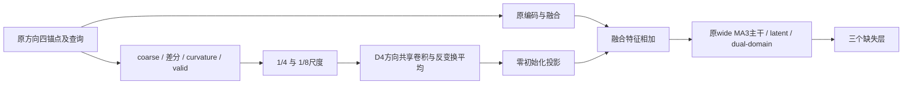

> **2026-09-23：本分支full已完成并停止。** +0.000426dB，CI跨零，未晋级；不运行plain消融或重复下方历史指令。详见[复核报告](results/full_review.md)。下一步：`design/pastnet_series_integrity`。

# PAST-Net frame-context：保留解剖方向的共享局部结构分支

**2026-09-22：实现、机制与容量检查、两分支smoke、恢复加载、指标复算和full入口核验全部通过，可运行下方shared full。** 真实训练峰值约19.80 GiB，推理延迟比原control增加约12.2%，仍在预登记1.5倍门槛内。

本轮独立结构假设：完整主干继续处理原方向图像，新增低分辨锚点上下文分支共享八个D4方向的局部映射；在宽MA3主干之前注入特征。模型总参数1,006,163，新增13,984。原linear coarse、bounded residual、四锚点、多尺度latent、dual-domain和训练方案保留。

方向增强的full已按协议停止：+0.094388dB未达到+0.10，HD95 intensity-proxy显著退化。详见[旧分支复核](../pastnet_orientation/results/full_review.md)。本包从原G086开始，不使用失败分支的权重或随机图像增强。



新分支提供的是方向共享的表示约束，没有增加观测层或target信息。只保证新增分支的方向等变性，完整网络仍可利用解剖坐标先验。群平均是已知方法，本轮不宣称其理论原创或已取得SOTA。

完整检查结果以 [full前核验](results/pre_full_review.md) 和 `results/final_verification.json` 为准。用户当前只运行：

```powershell
Set-Location D:\MRI
powershell -NoProfile -ExecutionPolicy Bypass -File .\design\pastnet_frame_context\full.ps1 -Seed 3407
```

默认 `shared`。microbatch2×累积8，checkpoint前5/10个主干blocks；80轮上限，原min30/patience15，AdamW+warmup cosine+EMA；只使用clean validation选最佳checkpoint。中断后末尾加 `-Resume`，源代码、协议和入口在full后冻结。脚本结束自动测完整推理效率，八方向低分辨分支的成本全部计入。

第一门槛为shared相对原control至少+0.10dB，并通过CI/胜率/困难四分位/质量/tail10/效率守卫。通过后才运行同参数、同初始化、同位置的plain分支消融；shared相对plain至少+0.03dB及其余守卫通过，才能归因于方向共享。失败即停止。最终三seed与外部IXI/NingXia评估仍须单独晋级和锁定。

- [计算前协议](PROTOCOL_ZH.md)
- [运行与后续判定](docs/运行指令.md)
- [非零分支等变性检查](results/checks.json)
- [固定训练区间容量检查](results/capacity.json)

历史test表、论文结论和已有checkpoint不覆盖；本地validation反复开发后的结果不冒充独立最终测试。
