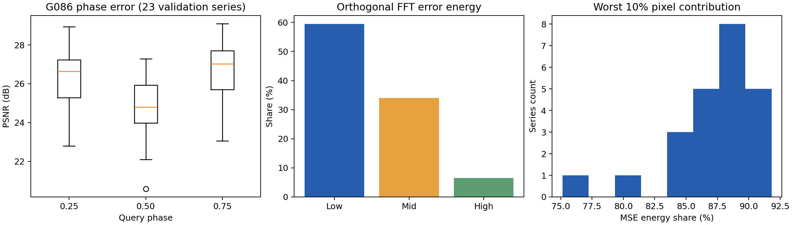
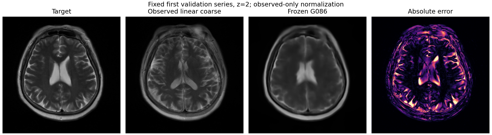

# 第一性原理审计：信息、误差与评价边界

## 1. 事实来源及复核

用户给出的路径使用了转义下划线；实际入口为 `design/design1_pastnet/`，已阅读 README、experiment_ledger、next_sota_handoff、ARTIFACT_INDEX。数值以原始 CSV/checkpoint 为准。

[历史逐病例复核 JSON](../results/historical_evidence.json) 保存路径、哈希和 10,000 次病例 bootstrap。下表仍是已反复开发的 test-24，只用于描述既有证据，不参与 v2 选型。

| 配对 | PSNR 均值差 | 95% CI | win | MAE 差 |
|---|---:|---|---:|---:|
| G079 − G078，仅 tail loss | +.064959 | [.056478,.073156] | 24/24 | +.104282 |
| G084 − G079，双域 residual | +.039189 | [.034601,.043715] | 24/24 | −.174444 |
| G086 − G084，续训 | +.004633 | [.003807,.005406] | 23/24 | −.020643 |

G086 的正式 CSV 为 24.446977 dB；继续优化的收益低于旧 `.03 dB` 门槛。IXI G07 29.9892、I3Net 31.3058 的反转仍需正视；IXI 固定 G086 full checkpoint 在本次核验时不存在。没有把 IXI smoke 写成性能证据。

## 2. 数据审计发现了什么

**患者交叉。** 旧 fastMRI train=112、val=24、test=24 个 series。患者 `101014598432` 在 train/val 各有一个 series；G086 已见过其训练数据，因此其 validation series 在新 manifest 中标记为 `quarantine`。保留原训练集合，以免再次引入训练分布变量；新 validation 为 23 名患者。其余 train/val/test 患者集合无交叉，旧文件不改。

**方向丢失。** `processing/fastmri_brain_t2_prepare.py` 按 InstanceNumber 堆叠，并写对角 affine，不能把其方向矩阵当作患者方向。v2 从 DICOM 读 ImageOrientationPatient、ImagePositionPatient、PixelSpacing，按旧顺序排列，核对首/中/末切片像素与旧 NIfTI 一致；由真实位置投影计算 z，而不是把 SliceThickness 当层间距。134/135 个 train/val series 核验成功。训练病例 `113452254821_ax_t2` 位置不单调，保持旧图像并置 geometry-known=0，不能伪造毫米值。未来修复该病例的排序必须作为独立数据实验，不能混入本轮结构消融。

数组轴为 `[row index, column index, slice]`；对应的 DICOM 两个方向向量需正确映射，LPS 转 RAS。NingXia 原转换代码的 affine 前两列与 `pixel_array` 轴顺序不同，v2 sidecar 交换其 in-plane 方向/spacing；不改图像数据。方向/位置定义依据 [DICOM Image Plane Module](https://dicom.nema.org/medical/DICOM/2021b/output/chtml/part03/sect_C.7.6.2.html)。

**归一化的隐藏信息。** 旧 loader 使用完整目标体的最小/最大值，稀疏输入由缺失层极值参与缩放。v2 只从当前模拟采集网格的真实观测层计算 min/max；target 使用同一变换，允许超出 [0,1]，训练/评估不裁剪，以免把高亮真值截断。训练每个 z%4 网格独立归一化；validation 固定 z=0,4,...。所有新实验与 control 共用该政策。

## 3. D1/D2：23 个干净 validation 的实际误差

先用冻结 G086 和旧归一化做可追溯诊断；输入分辨率 256×256，逐 missing slice 计算 range=1 的 PSNR，再病例等权平均。这里不是旧论文表的 native-volume 口径。

| phase | G086 PSNR | MSE |
|---|---:|---:|
| .25 | 26.246844 | .002605711 |
| .50 | 24.742212 | .003707354 |
| .75 | 26.710280 | .002328055 |

中心层最差，符合长间隔下非线性解剖变化和结构出现/消失更难预测的假设；这并不单独证明“形变就是全部原因”。

剩余 MSE 的互斥 FFT 频带能量约为 low 59.46%、mid 34.03%、high 6.51%。频率阈值固定为 `.10/.28 cycles/pixel`，掩码互斥、Parseval 能量可加。最差 10% 像素平均承载 87.42% 的误差能量；target 梯度最高 10% 区域的 MSE 约 .012718，明显高于总体 .002880。

因此只增强高频纹理缺乏依据；低频轨迹与中频边界需要不同处理。hard-tail 的历史 MAE 代价也有现实解释：对少数大错区域用力可能扰动更广泛的低幅误差。

## 4. D3/D4：信息探针，不冒充可达到的上限

所有探针只跑上述 23 个 validation series；参数预先固定，未按病例调参。原始结果：[per_slice.csv](../results/audit_validation/per_slice.csv)、[per_case.csv](../results/audit_validation/per_case.csv)、[summary.csv](../results/audit_validation/summary.csv)。

| 探针 | 平均逐 slice PSNR | 能解释什么 |
|---|---:|---|
| 线性插值 | 20.786566 | 基础非线性偏离很大 |
| 冻结 G086 | 25.899779 | 成熟先验已显著超过简单融合 |
| target 辅助固定 TV-L1 对齐左右锚点再融合 | 25.757022 | 此配准实现没有显示超过 G086 的明确余量 |
| target 投影到局部四锚点逐像素强度包络 | 26.123840 | 同位置锚点可供选择的强度范围 |
| target 投影到六槽真实稀疏锚点包络 | 26.855144 | 外侧真实观测可能增加可选信息 |
| 加入更近真实邻层、仍仅线性平均 | 23.459073 | 增加信息不等于简单估计器就能利用 |
| 用 target 的低频替换 coarse 低频 | 26.635417 | 低频误差移除的敏感性；需要不可用的目标信息 |

TV-L1 在 96×96 上固定求流后回到 256×256，利用 target，禁止进入训练输入或测试模型。有限能力的配准低分**不能证明**完美对应没有收益，也不能以此声称 Flow 的信息论上限低于 26。

强度包络 `clip(target, min(anchors), max(anchors))` 是允许逐像素使用真值选融合权重的乐观探针。它只约束“同位置凸融合”这类估计器；生成 residual 可以越过包络，因此不是整个 PAST-Net 的 PSNR 上限。低分也不代表不可约误差。

fastMRI 所有这些体积只有 16 层，完整 x4 采集只有 4 个唯一真实观测。局部四槽在首尾 interval 含重复边界，六槽可以取得局部窗口遗漏的第四个真实观测，**并没有凭空获得 6 层采集**。未来 context 消融必须同时报告有效 anchor 数和实际毫米覆盖；不得把插值层当新观测。

条件平方误差的理论最优风险是 `E[Var(Y | observed anchors, geometry)]`。本仓库没有同一观测条件下的独立重复真值，无法估计该条件方差，因此目前没有严格 Bayes 上界/下界或“必到 26”的依据。26−24.447≈1.553 dB 对应同口径约 30.1% 的 MSE 比例下降；当汇总为平均 PSNR 时，准确对应的是几何平均 MSE 比，而不是必然等价于算术平均 MSE 降幅。

## 5. D5：三域物理尺度差异

仅打开 train/validation；NingXia 固定参考 fold_00，未读其 held-out 患者。几何统计覆盖全部可用训练/验证头信息；强度、邻层变化和高通 MAD 描述量只取各域固定前 12 个 series，并在 CSV 显式标记采样。高通 MAD 混有真实纹理，不当作严格噪声估计。

| 数据 | 几何样本数 | z-spacing 中位数 | x4 间隔中位数 | 层数中位数 | 真实 sparse 层数中位数 |
|---|---:|---:|---:|---:|---:|
| fastMRI | 134（另 1 未知） | 5.00 mm | 20.00 mm | 16 | 4 |
| IXI | 462 | 1.25 mm | 5.00 mm | 130 | 33 |
| NingXia fold_00 train/val | 20 | 4.40 mm | 17.60 mm | 18 | 5 |

fastMRI x4 间隔范围约 8–26 mm，IXI 约 4.80–5.12 mm，NingXia 约 17.60–24.00 mm；同时 FOV、面内分辨率和可用长程上下文差别明显。物理条件因此是有来源的新信息；“它造成了全部 IXI 差距”仍只是待检验假设。原始 [域审计 CSV](../results/domain_audit/per_series.csv) 保留完整方向矩阵、validity、FOV 和强度描述。

## 6. 新评价合同的冻结基点

完成上述诊断后，另在相同干净 validation 上用**观测层归一化、无输出 clamp**评估冻结 G086：PSNR **25.515590**、SSIM **.834136**、MAE **.024794**、MSE **.00314214**、NCC **.938926**。

此处 MAE/MSE 是观测强度范围归一化单位。与旧归一化诊断分数的差同时包含动态范围及输出 clamp 的变化，不能单独归因为泄漏，也不是模型结构退步。所有正式消融将与同规范、同训练预算的 control 配对。

图固定取 manifest 第一个 validation series、首 interval 的中心层，不按 test 或模型改善选“漂亮病例”。目前没有经过 v2 full 训练的预测图。
