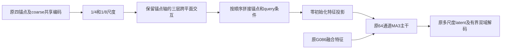

# PAST-Net LACV：保留真实锚点轴的跨平面交互

**2026-09-15：E1 full 已完成，分支停止。** validation PSNR25.576666，比同预算control提高.014654 dB，95%患者配对CI[.009460,.020979]，22/23患者改善；全部质量与效率guard通过，但未达预登记+.10 dB效应门槛。没有进入同容量E2、额外seeds或外部测试。旧代码和checkpoint保持原样，详见[full复核](results/crossview_full_review.md)。

核心假设：保留四个真实锚点的独立特征，先在(anchor,x)/(anchor,y)平面上进行非线性交互，再按查询phase融合，能否补足早期加权融合丢失的结构关系？它不增加采集图像，也不把原G086的三个query latent mixer冒充真实锚点交互。



参数总计1,032,779，新增40,600。投影为零时与G086输出逐位一致。新增路径不会读取target、毫米/方向metadata或额外远端图像；无效锚点在每层屏蔽。跨平面本身已有先例，不把模块名字当作创新证据。

## 已完成的E1命令（留档，勿重复执行）

```powershell
Set-Location D:\MRI
.\design\pastnet_v2_crossview\full.ps1 -Variant crossview -Seed 3407
```

此命令已由用户完成，当前无需再运行full。能力检查的训练权重未保存、未用于full；本次full从原G086重新开始，保持原训练recipe及有效batch16。E1未通过，因此不运行 `per_anchor` 消融。

E1必须比同预算control提高至少.10 dB，即本seed validation≥25.662011，并满足CI、胜率、最差四分位、质量和效率guards。E1通过尚不能区分新增容量和跨平面机制；随后需对同容量 `per_anchor` 达到+.05 dB及同套guards。任一失败停止。通过后才补齐三seed，锁定后再进行外部同协议比较。

- [预登记协议](PROTOCOL_ZH.md)
- [设计依据和2026比较范围审查](docs/01_设计与SOTA边界.md)
- [分开的运行指令](docs/02_运行指令.md)
- [固定4区间能力检查](results/capacity.json)
- [完整反向传播显存和吞吐](results/bench_cp6.json)
- [正式入口、恢复、full前置检查及旧源码完整性核验](results/final_verification.json)

两臂真实trainer smoke均通过，crossview恢复运行通过；full入口的能力检查和参数解析已核验。E1 full实际forward为49.9073 ms/缺失层，比control慢4.64%；训练峰值19.2569 GiB allocated /19.4141 GiB reserved，训练循环16.5025小时。卷积/线性算子统计两臂均448.853 GFLOPs/三层区间（含per_anchor functional卷积，非全部算子FLOPs）。

## 已完成的低成本证据

冻结G086，仅新增路径96步：固定四个训练区间MSE由.00198296降到.00174015（下降12.24%），MAE由.0228601降到.0216120。此结果只证明可学习性，来自两个训练series，不是泛化收益、不是validation晋级、不是SOTA。

RTX5090 D v2，256²，microbatch2，checkpoint前6/10 blocks，原完整loss含正反顺序两次网络计算：crossview峰值19.279/19.994 GiB allocated/reserved；per_anchor为19.409/20.121 GiB。训练计算约420ms/区间，不含IO，full还包含EMA、validation和checkpoint开销。约20GB预算满足，没有人为填充显存。
